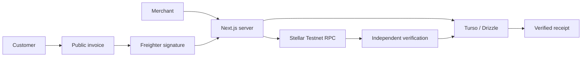

# StellarInvoice

**Open-source invoicing with native XLM payments on Stellar Testnet.** Share an invoice, sign with Freighter, and receive a receipt after independent Stellar ledger verification.

> **Testnet only. Testnet XLM has no monetary value. Never send real funds.** This experimental MVP is not an audited payment service.

## Why StellarInvoice?

Freelancers and small businesses need a clear connection between an invoice and its payment. StellarInvoice binds the exact XLM amount, destination and invoice reference to a server-prepared Stellar transaction. The ledger determines whether the invoice is paid; a wallet acknowledgement does not.

## Product flow and features

Merchant signs in with GitHub → saves a Testnet receiving address → creates and shares an invoice → customer connects Freighter → reviews and signs → server submits and independently verifies → invoice becomes PAID → verified receipt.

- Database sessions and owner-scoped invoice management.
- Exact integer-stroop amounts, destination snapshots and random public links.
- Explicit wallet connection, Testnet and payer checks around signing.
- Persistent attempts, bounded rechecks, atomic settlement and replay protection.
- Safe public/merchant receipts with verified hashes and Testnet explorer links.
- Responsive pages, keyboard focus, loading and recovery states.

The maintainer reported a successful manual 5 XLM Testnet payment through this flow, including the payer balance change and receipt. Automated tests use isolated databases and mocked wallet/RPC responses; they do not replace browser acceptance.

## Architecture and stack

Next.js App Router, React, strict TypeScript and Tailwind CSS provide server-rendered pages and client wallet controls. Auth.js/NextAuth uses GitHub OAuth and the Drizzle adapter. Turso stores SQLite-compatible data through Drizzle ORM and `@libsql/client`. The Stellar SDK stays server-side; `@stellar/freighter-api` handles browser wallet messaging.



See [architecture](docs/architecture.md), [payment flow](docs/payment-flow.md), [backend details](docs/payment-backend.md) and [Freighter guide](docs/freighter-payments.md).

## Stellar and transaction security

The server prepares one native XLM payment with exact amount, destination snapshot, unique text memo, source sequence, fixed 100-stroop fee and five-minute validity window. Freighter signs the original XDR with the Testnet passphrase. No wallet private key or recovery phrase reaches the app.

The server validates signed contents against the saved envelope/hash. Submission acknowledgement never settles an invoice. Verification checks RPC Testnet identity, hash, envelope, successful operation result, ledger and close time. A single database transaction records the unique payment, PAID invoice and VERIFIED attempt. Constraints and conditional updates prevent replay and duplicate credit.

Uncertain attempts recover by saved hash, never automatic replacement. Unpaid expiry requires retained RPC history covering the entire validity interval; wall-clock expiry alone is insufficient.

## Screenshots

Screenshots are not committed yet. Add sanitized images under `docs/images/` for the merchant list, public payment review and receipt. Use demo data; exclude customer details, session information, sensitive wallet popup contents and live invoice bearer links.

## Local setup

Use Node.js **24.15.0** (`.nvmrc`) and npm 11+. From the repository root:

```sh
npm ci
cp .env.example .env.local
```

PowerShell: `Copy-Item .env.example .env.local`. Do not overwrite an existing configured file. Fill placeholders locally, complete the setup below, then run:

```sh
npm run db:migrate
npm run dev
```

Open [localhost:3000](http://localhost:3000). Landing page, tests and build work without credentials. Auth/database routes require setup. Without auth configuration, sign-in explains setup is pending and private routes redirect to sign-in.

### Environment variables

| Variable | Purpose |
| --- | --- |
| `AUTH_SECRET` | Locally generated random secret, at least 32 characters |
| `AUTH_GITHUB_ID` | GitHub OAuth App client ID |
| `AUTH_GITHUB_SECRET` | GitHub OAuth App client secret |
| `AUTH_URL` | Canonical origin; localhost:3000 for local setup |
| `TURSO_DATABASE_URL` | Turso libsql:// or HTTPS connection URL |
| `TURSO_AUTH_TOKEN` | Database token with required read/write access |
| `STELLAR_RPC_URL` | Trusted HTTPS Testnet RPC; example supplies the public endpoint |

Generate AUTH_SECRET using a local cryptographic secret generator; store it only in `.env.local` or a deployment secret manager. Never commit `.env.local` or use NEXT_PUBLIC variables for secrets. The network passphrase is public. Windows environments with an installed trusted enterprise CA may need `NODE_OPTIONS=--use-system-ca`; never disable TLS verification.

### Turso and migrations

Create a database in [Turso](https://turso.tech/) and obtain its URL and database token. Set the two Turso variables and run `npm run db:migrate`. Drizzle reads `.env.local`, then `.env`; shell variables take precedence. Review the target before migrating: this command writes to the configured database. See [Turso SDK docs](https://docs.turso.tech/sdk/ts).

Checked-in migrations create authentication tables, invoices/receiving accounts, then attempts/payments. Milestone 6 adds no migration. Builds, tests and startup never migrate the remote database. For reviewed schema changes, run `npm run db:generate` and commit SQL plus metadata. Tests migrate disposable SQLite databases.

### GitHub OAuth

Create a GitHub OAuth App under Settings → Developer settings → OAuth Apps. Use homepage `http://localhost:3000` and callback `http://localhost:3000/api/auth/callback/github`. Store the client ID/secret locally, set AUTH_SECRET and restart. Deployments need a separate OAuth App and matching canonical HTTPS callback. Only trust proxies that overwrite forwarded host/protocol headers. Dangerous email-based account linking is disabled.

### Freighter and Friendbot

Install [Freighter](https://www.freighter.app/) in your desktop browser, unlock it and select Stellar Testnet. Save the merchant public G-address in Settings and choose a different payer. Both accounts must exist on Testnet.

Use Freighter's Testnet funding option or [Stellar Lab account tools](https://developers.stellar.org/docs/tools/lab/account) to fund a public address with Friendbot. [Friendbot instructions](https://developers.stellar.org/docs/build/guides/transactions/create-account) never require a secret key. The RPC must report the fixed Testnet passphrase; other networks are rejected.

See [manual acceptance](docs/freighter-payments.md#minimal-manual-acceptance-test). The accepted payment need not be repeated for docs or CI work.

## Commands and testing

| Command | Purpose |
| --- | --- |
| `npm run dev` | Development server |
| `npm run lint` | ESLint, zero warnings |
| `npm run typecheck` | Route generation and strict TypeScript |
| `npm test` | Isolated database, transaction, wallet and resilience tests |
| `npm run build` | Production build |
| `npm start` | Serve production build |
| `npm run db:generate` | Generate migration for review |
| `npm run db:migrate` | Apply migrations to configured database |

CI runs npm ci, lint, typecheck, tests and build on pull requests and pushes to main. It needs no OAuth/Turso secrets, Freighter or signing keys. Require its `checks` job after the first successful GitHub run.

## Limitations and roadmap

No invoice editing/cancellation, email delivery, PDFs, refunds, fiat conversion, organizations or recurring billing. No Mainnet, additional assets/wallets, AI or smart contracts. Address validation checks format/checksum, not ownership. Fixed fees may be rejected during surge pricing. Testnet resets and finite RPC history can require operator reconciliation; never delete unresolved attempts or assume failure.

Public URLs are bearer links: holders can read public details and initiate attempts. Customer email/internal owner metadata are excluded; descriptions and chain addresses are public. Restrict database/log/backup access. No distributed rate limiter is included; configure hosting-level request limits and monitoring before broad deployment. Bounded retries cannot repair external outages.

Next maintenance priorities: GitHub CI, sanitized screenshots, release review and deployment operational controls. New product scope needs a separate proposal. No Stellar Wave acceptance, affiliation or security certification is claimed.

See [release notes/dependencies](docs/release-readiness.md), [CONTRIBUTING](CONTRIBUTING.md) and [SECURITY](SECURITY.md).

## License

[MIT](LICENSE). Attribution uses StellarInvoice contributors; no personal/organizational ownership is inferred. Testnet XLM has no monetary value. The license provides no warranty.
