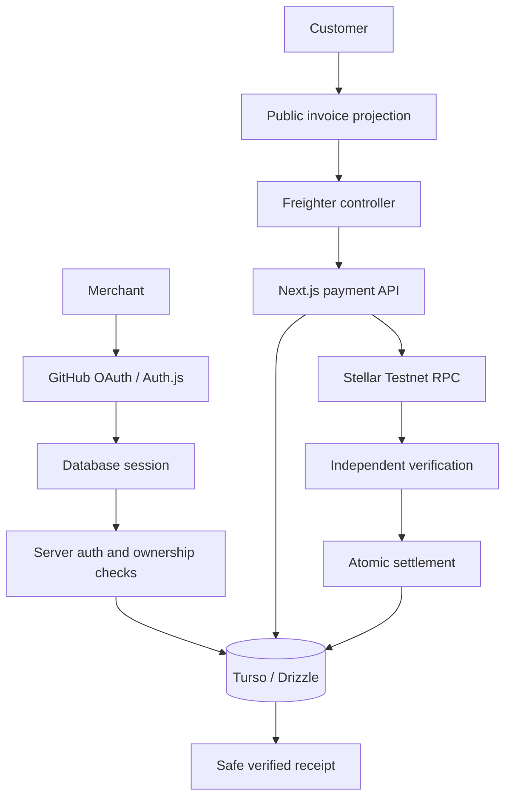

# Architecture

StellarInvoice is a Next.js App Router application with server-only persistence/payment modules and a client wallet controller. It uses native XLM on Stellar Testnet, not smart contracts.

## Boundaries

- `src/auth.ts`: GitHub only, database sessions, Drizzle adapter; session callbacks expose profile/ID/expiry, never OAuth tokens.
- `src/server/auth/session.ts`: verifies sessions at private entry points. Stores apply owner predicates; merchant receipt reads authenticate separately. Client session state/layouts are not authorization.
- `src/server/db/`: lazy server-only Turso client, schema and resilience; credentials come from server environment variables.
- `src/server/invoices/`: validates input and snapshots destination during creation; no client owner/destination is accepted.
- `src/server/payments/`: preparation, validation, submission, RPC checks, settlement and receipt projection. Stellar SDK stays server-side.
- `src/client/payments/`: response validation, Freighter messaging and recoverable UI state. React is not settlement authority.

## Data model

| Table | Role / constraints |
| --- | --- |
| users | Identity and nullable receiving G-address |
| accounts | Provider identity and sensitive OAuth data |
| sessions | Session tokens and expiry |
| invoices | Owner FK, unique 192-bit token, independent reference, exact stroops, destination snapshot, Testnet/XLM, OPEN or PAID |
| payment_attempts | Expected transaction/hash, validity/source/state; one active attempt per invoice |
| payments | Verified settlement; invoice, attempt and hash each unique |

Additive migrations preserve auth data. Only verification changes OPEN to PAID. Amount parsing uses decimal strings and BigInt, converting only safe positive integer stroops for storage. One XLM equals 10,000,000 stroops.

## Privacy and operations

Public invoices project amount, description, due date, status, destination, network, asset and reference. Receipts project verified amount, asset, network, source/destination, hash, ledger, close time and reference. Customer name/email, internal IDs, sessions/OAuth and signed envelopes are excluded. Receipt queries require PAID, VERIFIED and matching payment/attempt hashes.

Bearer links grant access; pages prevent indexing/shared caching/referrer sharing. Descriptions must not contain confidential data. Chain addresses are public. Signed XDR is stored server-side for recovery but must not enter logs/public responses. No wallet private keys are stored.

Database transport has an eight-second deadline. Only designated public invoice/status/receipt reads retry once after 250 ms on recognized transient errors. Writes, auth operations, submissions and settlement are not replayed for network errors. Existing bounded SQLite-lock retries remain separate. Outages cannot mark payments paid or failed.

CI uses disposable SQLite and mocked wallet/RPC responses. Deployment needs canonical HTTPS, OAuth callback configuration, trusted proxies, managed secrets, backups, request limits and monitoring. GitHub publication readiness is not unrestricted production readiness.
